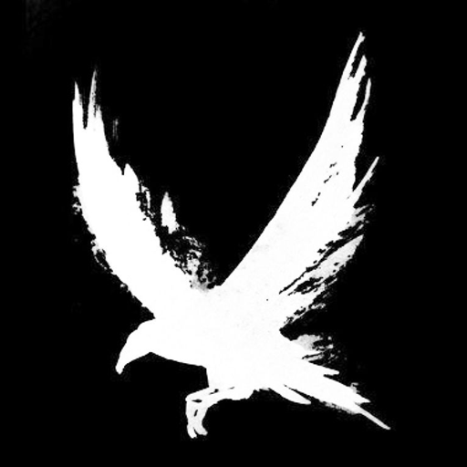

<div align="center">



# discord-nowcast (Linux & NixOS)

**Трек из любого приложения Linux или аккаунта Яндекс Музыки в статусе Discord.**

Яндекс Музыка (включая прямую синхронизацию через аккаунт), Spotify, SoundCloud, VK, Telegram, YouTube в браузере, Amberol, Rhythmbox, mpv, VLC: всё, что играет в Linux.

[](LICENSE)


[Инструкция по сборке (build.md)](build.md)

</div>

## Возможности

- **Полная совместимость с Linux и NixOS:** интеграция со стандартным протоколом MPRIS2 через DBus.
- **Подключение аккаунта Яндекс Музыки:** прямое отслеживание через Яндекс API/Ynison для устройств без медиасессий (или когда музыка играет на телефоне/колонке).
- **Сборка через Nix:** поддержка `nix build`, `nix run`, `package.nix`, flakes и классического `nix-build`.
- **Discord IPC:** взаимодействие через Unix Domain Sockets (`$XDG_RUNTIME_DIR/discord-ipc-0` и `/run/user/...`).
- **Обложки альбомов:** поиск обложек в высоком качестве через iTunes Search API и загрузка на медиахостинг для Discord.
- **Интеграция с systemd и XDG:** автоматический запуск через пользовательские сервисы systemd.

## Быстрый запуск

Сборка и запуск через Nix:
```bash
nix build
./result/bin/discord-nowcast --status
```

Подключение аккаунта Яндекс Музыки:
```bash
./result/bin/discord-nowcast --yandex-login
```

Подробные инструкции смотрите в [build.md](build.md).
